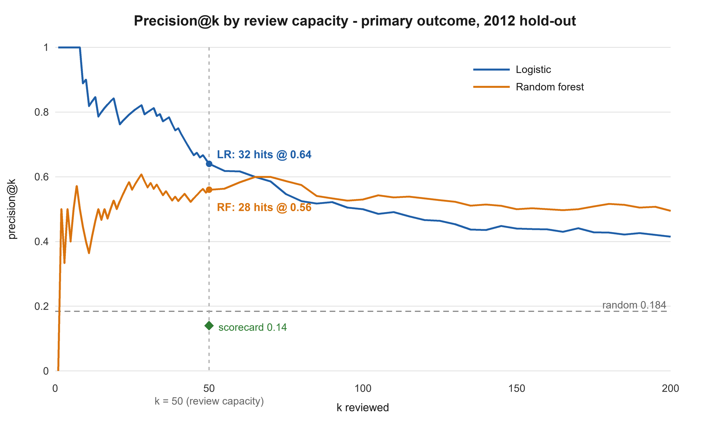

# CEO Pay Review Prioritizer

A compensation committee has time to examine only a small share of CEO pay packages each year — about 50 out of thousands. This project builds a model that ranks firm-years by the risk that the firm's ROA falls sharply in the following year, so the committee's limited review time goes to the cases that need it most. The model only recommends where to look first: it does not set compensation, does not accuse executives of misconduct, and does not claim that changing pay would improve performance.

## How it works

Each row is one firm-year and its CEO. The features use only information known in year t — pay level and pay mix, firm size, ROA, leverage, growth, past stock returns and CEO age — and the label marks a sharp ROA decline in year t+1. Models are trained on 2011 and evaluated on 2012 (a time-based split), then re-trained on 2011–2012 to score 2013 and produce the review list.

| Script | What it does | Main outputs |
|---|---|---|
| `build_panel.py` | merge the raw tables, clean, build 14 features and 3 label definitions | `results/panel.csv`, `results/missingness.csv` |
| `run_models.py` | ROA scorecard + logistic regression + random forest; time split; score 2013 | `results/lift_curve.csv`, `results/review_list_2013.csv`, `results/test_predictions_2012.csv` |

## How to reproduce

The raw input tables are not included in this repository: see `data/README.md` for the three files to place in `data/`. Outputs from one full run are committed under `results/`, so the results can be inspected without the raw data.

Environment: Python 3.10.9 · scikit-learn 1.2.1 · pandas 1.5.3 · numpy 1.23.5 (see `RUN_ENV.txt`; package versions in `requirements.txt`). Different library versions can change random-forest tree-building details and shift metrics by 1–2 points; align versions where possible.

```bash
pip install -r requirements.txt
python build_panel.py   # merge raw data → results/panel.csv
python run_models.py    # train/evaluate → results/*.csv
```

Both scripts resolve all paths relative to their own location: they read `data/` and write to `results/`, so they run identically from any working directory.

## Repository layout

```text
build_panel.py            merge, clean, build features and labels
run_models.py             scorecard + logistic regression + random forest; time split
docs/
  data-cleaning-decisions.md   how the raw tables were cleaned (in Chinese)
  modelling-notes.md           split, robustness, limitations (in Chinese)
data/                     raw input tables — not included; see data/README.md
results/                  committed run outputs (panel, metrics, review list, ...)
figures/                  fig1-workflow / fig2-lift / fig3-calibration (PNG)
requirements.txt
RUN_ENV.txt
LICENSE
```

## Key results (2012 hold-out, review capacity k = 50)

| Rule | True declines in top 50 | Precision@50 |
|---|---|---|
| Logistic regression (recommended) | 32 | 0.64 |
| Random forest | 28 | 0.56 |
| ROA scorecard ("worst performers first") | 7 | 0.14 |
| Random selection | ~9 | 0.18 |



Numbers: `results/metrics_full.csv`. The scorecard losing to random selection is a real finding, not a bug: firms that already look weak tend to recover (mean reversion), so ranking by current ROA is not just weak but counterproductive.

## Limitations

- Data cover 2011–2013 only; evaluation rests on a single hold-out year.
- No industry codes in the data: "industry-adjusted ROA" is approximated by full-sample quantiles.
- Labels are review signals, not judgments of pay fairness or executive conduct.
- Small sample and one test year: treat the results as a screening aid, not a verdict.

## Contributors

- Jie Cheng
- Dekang Lu
- Shiyu Zhong
- Yixuan Liu
- Zhanjian Li

## License

Released under the [MIT License](LICENSE).
